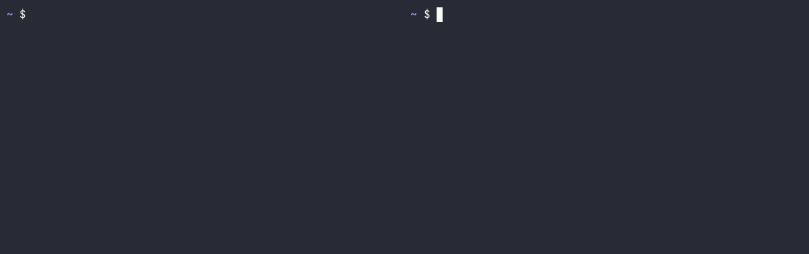

# foldl

foldl runs code when a shell enters or leaves a folder. It replaces direnv.
It adds what direnv leaves out: teardown when you leave a folder, and side
effects that outlive one shell (services, tunnels, containers), shared safely
between the many shells and agents working in the same folder. There is no
daemon.

| One server for every shell in the folder | Each worktree gets its own server and port |
|---|---|
|  |  |

More in [docs/demos.md](docs/demos.md): Claude Code sessions, killed
terminals that still clean up, aliases and functions, monorepos, Nix flakes,
rollback, and switching from direnv.

## Philosophy

- Zero-cost abstractions and optimal performance
- Safe concurrent access
- Easy to use and integrate into existing workflows
- Minimal dependencies
- Cross-platform support (Linux, macOS)
- Extensible and customizable
- Natively compatible with Nix developer shells
- Functional: a pure core folded over events, with all I/O at the edges

## Install

foldl is not published yet. Build it from this repository.

```sh
nix build                        # result/bin/foldl
cargo install --path crates/foldl
```

The flake also provides an overlay, a home-manager module and a NixOS module.
See [docs/nix.md](docs/nix.md).

home-manager:

```nix
programs.foldl = {
  enable = true;
  # package = pkgs.foldl;
  # enableBashIntegration = true;
  # enableZshIntegration = true;
  # settings = { verbosity = "normal"; };   # written to config.toml
};
```

Options: `enable`, `package`, `enableBashIntegration`,
`enableZshIntegration`, `settings`.

NixOS: `programs.foldl.enable = true;`

foldl supports bash and zsh on macOS and Linux.

## Shell setup

Add one line to your rc file.

```sh
# ~/.zshrc
eval "$(foldl hook zsh)"

# ~/.bashrc
eval "$(foldl hook bash)"
```

The hook runs at each prompt. When nothing changed it costs about a
millisecond. It adds to `precmd`/`chpwd` (zsh) and `PROMPT_COMMAND` (bash)
without replacing them. An internal `foldl hook-step` command does the work;
`foldl hold` keeps locks for shared migrations. Both exist for the hook and
are not meant to be run by hand.

## Quick start

```sh
cd ~/code/app
foldl new env          # creates .foldl/001-env/manifest.toml
$EDITOR .foldl/001-env/manifest.toml
foldl allow            # trust this folder's .foldl/
```

A manifest that needs no scripts:

```toml
# .foldl/001-env/manifest.toml
version = 1
path_add = ["bin", "node_modules/.bin"]

[env]
DATABASE_URL = "postgres://localhost/app"
TOOLS = "${FOLDL_ROOT}/tools"
```

At the next prompt foldl loads it:

```
foldl ↑ env (+3 vars)
```

`cd` out of the folder and foldl reverses it:

```
foldl ↓ env
```

An untrusted folder does not load. foldl tells you to run `foldl allow`.
Already using direnv? Run `foldl import direnv`.

## Migrations

A folder's setup is an ordered list of migrations in `.foldl/`:

```
.foldl/
  001-env/manifest.toml
  002-flake/manifest.toml
  003-postgres/{manifest.toml, up.sh, down.sh}
```

Entering the folder runs each `up` in number order. Leaving runs each `down`
in reverse. If an `up` fails, the migrations that already ran are rolled
back. Every ancestor's `.foldl/`, from `/` down, loads as one stack,
outermost first.

A migration is a directory named `<number>-<name>` with a `manifest.toml`.
`<name>` matches `[a-z0-9][a-z0-9-]*` and is the id used in commands, as in
`foldl redo postgres`.

**Scope** says who owns the effect.

- `session` (default): `up` runs when a shell enters, `down` when it leaves.
- `shared`: owned by a lease. `up` runs for the first session that holds the
  lease, `down` for the last. Crashed or closed shells are cleaned up too.
  A shared migration needs a custom `down`.

**Downs** say what undoes the effect. foldl always reverses the environment
changes it observed. A custom `down = "down.sh"` runs first, for things foldl
cannot see (files written, agents started, logins).

**Interactive** (`interactive = true`) migrations are sourced into your own
shell, so aliases, functions and completions work, and are removed on leave.
Session scope only.

**Local** migrations (`050-secrets.local/`) are personal. They merge into the
same order and are kept out of git. See
[docs/committed-or-not.md](docs/committed-or-not.md).

Scripts are `.sh` files with a shebang naming `bash`, `zsh` or `sh`.
`foldl new` writes `#!/usr/bin/env bash`.

### Manifest keys

Unknown keys are errors. Durations are strings such as `"500ms"`, `"30s"`,
`"5m"`.

| Key | Type | Default | Notes |
|---|---|---|---|
| `version` | integer | required | `1` |
| `scope` | `"session"` or `"shared"` | `"session"` | |
| `interactive` | bool | `false` | `session` only |
| `up` | path | `"up.sh"` if it exists | relative to the migration directory |
| `down` | path | `"down.sh"` if it exists | custom down; required for `shared` |
| `builtin` | `"nix-flake"` or `"dotenv"` | none | excludes `up`, `interactive` |
| `[builtin_options]` | table | `{}` | per built-in |
| `path_add` | array of paths | `[]` | prepended to `PATH`, relative to `FOLDL_ROOT` |
| `[env]` | table of strings | `{}` | values may interpolate, see below |
| `unset` | array of names | `[]` | variables to unset |
| `[aliases]` | table of strings | `{}` | `session` only |
| `lease` | `"folder"`, `"repo"` or a string | `"folder"` | `shared` only |
| `[ports]` | table of `"auto"` | `{}` | `shared` only |
| `timeout` | duration | `"60s"`, `"10m"` for `nix-flake` | per `up` |
| `down_timeout` | duration | `"30s"` | per `down` |
| `watch` | array of globs | `[]` | relative to `FOLDL_ROOT`; a change counts as the migration changing |

A manifest must do something: at least one of `up`, `builtin`, `path_add`,
`[env]`, `unset`, `[aliases]`.

On `up`, foldl applies `path_add`, `[env]`, `unset`, `[ports]`, the built-in
or `up` script, then `[aliases]`. On leave it runs the custom `down`, then
the derived inverse.

`[env]` values may use `${FOLDL_ROOT}` (the folder holding `.foldl/`),
`${FOLDL_STATE}` (the migration's state directory), `${HOME}` and names from
`[ports]`. Nothing else is expanded; any other `${NAME}` is a validation
error. `$$` is a literal `$`.

Built-ins:

- `nix-flake`: option `flake` (default `"."`). See [docs/nix.md](docs/nix.md).
- `dotenv`: options `file` (default `".env"`) and `required` (default
  `true`).

Examples:

```toml
# 003-postgres/manifest.toml (up.sh and down.sh next to it)
version = 1
scope = "shared"
down_timeout = "30s"

[ports]
PGPORT = "auto"
```

```toml
# 004-tools/manifest.toml: aliases, functions, completions
version = 1
interactive = true

[aliases]
t = "just test"
```

```toml
# 005-aws/manifest.toml: shared by every folder using this profile
version = 1
scope = "shared"
lease = "aws-sso:dev"
```

`lease = "folder"` gives each git worktree its own instance. `"repo"` shares
one instance between worktrees. Any other string is a custom key shared by
every folder that uses it. `"auto"` ports are picked free at `up` time,
exported to `up` and `down`, and replayed to joining sessions.

An optional `.foldl/foldl.toml` holds folder settings:

```toml
version = 1

[trust]
reuse = "repo"   # default "none"
```

With `reuse = "repo"`, a worktree or clone of the same repository whose
`.foldl/` has the same content is trusted without `foldl allow`. A clone
counts as the same repository when it shares history and a remote URL with
the allowed one, so a fork needs its own `foldl allow`.

## Trust

`foldl allow` hashes the whole `.foldl/` directory, local migrations
included, and shows what changed since the last allow. Files in local
migrations are listed as changed but their contents are not shown, since
they often hold secrets. Nothing loads from a
folder that is not allowed. A folder is allowed, denied (`foldl deny`: not
loaded, and foldl says so) or ignored (`foldl ignore`: not loaded, silent).
Non-interactive runs never prompt. You can also trust whole directory trees
with `trusted_prefixes` in [the config](docs/configuration.md).

If a loaded folder changes, it stays loaded and foldl asks you to run
`foldl allow`. A changed `session` migration then reloads at the next
prompt. A changed `shared` migration is not restarted under other sessions;
run `foldl redo <name>`.

Trust covers `.foldl/` only. As with direnv, files outside it that a
migration uses (`.env`, `flake.nix`, `path_add` directories, scripts that
`up.sh` runs) can change without another `allow`. If agents work in your
folders, don't let them run `foldl allow`. [SECURITY.md](SECURITY.md) has
the details, a line for `AGENTS.md` and how to report a vulnerability.

## Commands

Every command takes `-q`/`--quiet` (errors only) and `-v`/`--verbose`
(variable names and timings). `-h` prints help.

### `foldl hook`

`foldl hook <bash|zsh>` prints the shell hook. Put
`eval "$(foldl hook zsh)"` in your rc file.

### `foldl allow`

`foldl allow [DIR]` validates the folder, prints what changed in `.foldl/`
since the last allow, and allows it. Typing the command is the confirmation.
Invalid folders are refused (exit 78).

### `foldl deny`

`foldl deny [DIR]` marks the folder denied. It does not load and foldl says
so.

### `foldl ignore`

`foldl ignore [DIR]` marks the folder ignored. It does not load and foldl
says nothing. Use it for `.foldl/` directories that are templates.

### `foldl check`

`foldl check [DIR]` validates the folder's manifests: the schema, scope-only
keys, shebangs, files outside the migration directory, and a `shared`
migration without a custom `down`. It warns about `session` scripts that run
commands with outside effects (`docker`, `ssh-agent`, ...) and about
`nix-flake` without `nix` on `PATH`.

### `foldl new`

`foldl new <NAME> [--shared] [--interactive] [--local] [--private | --committed]`
creates the next numbered migration (three digits, or the widest existing
prefix). It uses the nearest folder with a `.foldl/`, else the git top
level, else the working directory.

- `--shared`: owned by a lease (first session up, last session down).
- `--interactive`: sourced into your shell, for aliases, functions and
  completions.
- `--local`: personal, named `<number>-<name>.local`, ignored by git.
- `--private`: on first use in a repository, keep `.foldl/` out of git via
  `.git/info/exclude`.
- `--committed`: on first use, plan to commit `.foldl/`. This is the default
  when there is no terminal.

See [docs/committed-or-not.md](docs/committed-or-not.md).

### `foldl up`

`foldl up <NAME>` loads a migration that you unloaded with `foldl down`. The
change is carried out at the next prompt, because a subprocess cannot change
your shell's environment.

### `foldl down`

`foldl down <NAME> [--force]` unloads a migration at the next prompt. Later
migrations in the stack are unloaded and reloaded with it. `--force` retries
a dirty shared migration's `down` right away and needs no session.

### `foldl redo`

`foldl redo <NAME>` reloads a migration at the next prompt. For a shared
migration it restarts it, even while other sessions hold the lease; foldl
warns and names them. Other sessions keep their copy of the environment
until they re-enter.

### `foldl status`

`foldl status [--all] [--json] [--events]` shows the folder's migrations,
their state, holders and dirty leases.

```
~/code/app  (3 sessions)
  001 env        session up
  002 postgres   shared  up     holders: zsh 4121, claude 5530
  003 tunnel     shared  DIRTY  down failed 10:42 -> foldl down --force tunnel
```

`--all` also lists every session. `--json` prints machine-readable output.
`--events` prints this session's event log. A folder with a private
`.foldl/` shows `private (not committed)`.

### `foldl logs`

`foldl logs <NAME>` prints the full output of a migration's last run in this
session. The name resolves in the current stack, innermost folder first.
Logs are mode 0600 and are not redacted.

### `foldl exec`

`foldl exec [DIR] [--json] -- <CMD>...` loads the folder, runs the command in
it, and unloads. It exits with the command's own status. If your session
already has the folder loaded, it joins that session. Use it for one-off
commands and from agents. See [docs/agents.md](docs/agents.md).

### `foldl export`

`foldl export <bash|zsh|json> [DIR] [--json]` prints the folder's
environment. `json` is meant for editors and tools. In an agent session it
reuses the loaded session. Otherwise it loads, prints and unloads again, so
services started by an `up` are stopped.

### `foldl session`

For agents that have no long-lived shell.

- `foldl session start [--id <ID>] [--parent <PID>] [--json]` starts a
  session with no shell, or reuses the one with that id, and prints
  `export FOLDL_SESSION=...`. The session lives while `--parent` (default:
  the caller) lives.
- `foldl session stop [--id <ID>]` unloads everything the session loaded and
  ends it.

### `foldl integrate`

`foldl integrate claude [--project]` installs Claude Code `SessionStart` and
`CwdChanged` hooks, in `~/.claude/settings.json`, or with `--project` in the
project's `.claude/settings.json`. See [docs/agents.md](docs/agents.md).

### `foldl import`

`foldl import direnv [DIR] [--yes] [--shared <NAME>] [--dry-run] [--remove-envrc] [--private | --committed]`
converts an `.envrc` into `.foldl/`.

1. Known direnv calls (`use flake`, `dotenv`, `PATH_add`, `export`) become
   built-ins and `[env]` entries. Everything else is kept verbatim in an
   `envrc` session migration, flagged for review.
2. Lines that start things outside the shell (`&`, `nohup`, `docker`,
   `compose`, `pg_ctl`, `ssh -f`, `systemctl`) can go into a shared migration
   with a `down.sh` listing suggested stop commands. On a terminal foldl
   asks. `--shared <NAME>` does it without asking. `--yes` keeps them in the
   session script.
3. If direnv already allowed the `.envrc`, foldl compares
   `direnv export json` with `foldl export json` and shows differences. foldl
   never allows the `.envrc` for direnv. Both sides run the code.
4. It runs `direnv deny` for you. `--remove-envrc` also deletes `.envrc`,
   which switches the whole team off direnv.
5. It writes `.foldl/`. Only if direnv had allowed the `.envrc` does it
   run `foldl allow` too; otherwise review `.foldl/` and allow it yourself.

`.foldl/` must not exist yet. `--dry-run` prints the migrations instead of
writing them.

## Exit codes

Codes are stable. `foldl exec` returns the command's own status once the
folder has loaded; the codes below apply to foldl's own failures.

| Code | Name | Meaning |
|---|---|---|
| 0 | `ok` | success |
| 64 | `usage` | bad command line |
| 69 | `unavailable` | a needed program is missing (`nix`, `bash`, `zsh`) |
| 70 | `internal` | a bug in foldl |
| 75 | `dirty` | a dirty lease and `on_dirty = "abort"` |
| 77 | `untrusted` | folder not allowed |
| 78 | `invalid` | manifest or `foldl.toml` failed validation |
| 80 | `up_failed` | an `up` failed; earlier migrations were rolled back |
| 81 | `down_failed` | a `down` failed; the lease is dirty |
| 82 | `timeout` | an `up` or `down` exceeded its timeout |
| 83 | `denied` | folder explicitly denied |
| 130 | `interrupted` | Ctrl-C |

## Documentation

- [Committed or not](docs/committed-or-not.md)
- [Nix](docs/nix.md)
- [Agents](docs/agents.md)
- [Configuration](docs/configuration.md)
- [DESIGN.md](DESIGN.md), the full specification

## License

[MIT](LICENSE)
