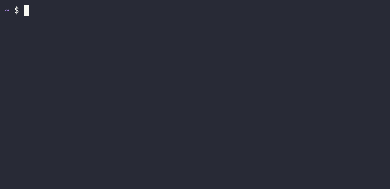
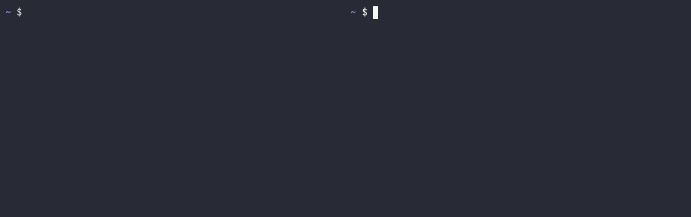
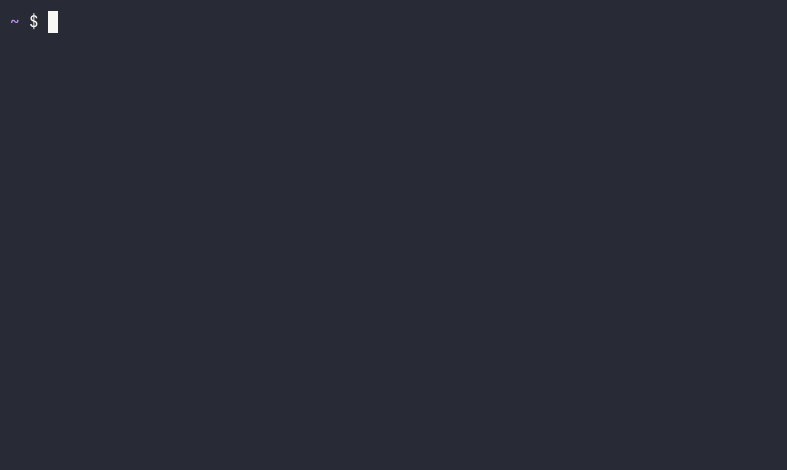
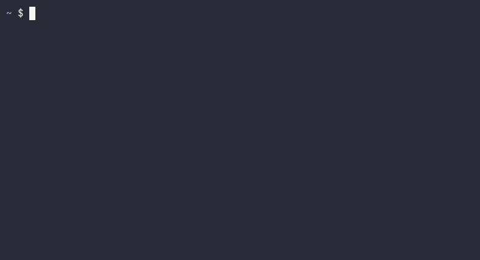

# Demos

Every demo is recorded in a real interactive zsh with foldl's prompt hook,
in a fresh home directory. `scripts/demos` types the commands, writes an
asciicast file next to each GIF, and renders the GIF with
[agg](https://github.com/asciinema/agg). Re-record them after output
changes:

```sh
nix build && nix develop -c scripts/demos            # all of them
nix develop -c scripts/demos shared                  # one
```

- [Enter and leave](#enter-and-leave)
- [Shared services](#shared-services)
- [Killed terminals](#killed-terminals)
- [Worktrees](#worktrees)
- [Aliases and functions](#aliases-and-functions)
- [Nested folders](#nested-folders)
- [Nix flakes](#nix-flakes)
- [Editing a loaded folder](#editing-a-loaded-folder)
- [Rollback](#rollback)
- [Dirty leases](#dirty-leases)
- [Status and logs](#status-and-logs)
- [Switching from direnv](#switching-from-direnv)

## Enter and leave

`app/.foldl/` sets a variable, adds `bin` to `PATH` and defines an alias. The
first `cd` is refused until the folder is allowed; `foldl allow` shows what
will run. Leaving undoes all of it.



## Shared services

The `server` migration has `scope = "shared"` and a `[ports]` entry. The
first shell to enter starts a web server on a free port; the second joins
it and gets the same port. When the first shell leaves, the server is kept
because another shell still uses it. When the last one leaves, it stops.



## Killed terminals

The same server, but the last shell using it doesn't leave cleanly: it is
killed with `kill -9`, as when a terminal window is closed. Each shell has
a small holder process that notices its shell is gone and runs the leave
for it, so the server still stops.


## Worktrees

The same `server` migration, in a repository with two worktrees. The
default `lease = "folder"` gives each worktree its own server, and
`[ports]` gives each its own port, so they never collide. With
`reuse = "repo"` in `.foldl/foldl.toml`, the second worktree loads without
another `foldl allow`, because its `.foldl/` matches what was allowed.


## Aliases and functions

An `interactive = true` migration can define aliases, functions and
completions in your shell. Here it replaces your own `ll` alias and adds a
`deploy` function. Leaving removes both and gives you your `ll` back.


## Nested folders

Every ancestor with a `.foldl/` loads, outermost first. In this monorepo the
root sets the toolchain and each service adds its own variables. Moving
between services swaps only the service's migrations; the root's stay
loaded until you leave the repository.


## Nix flakes

The `nix-flake` built-in loads a flake's dev shell, like nix-direnv. The
first load evaluates the flake; later ones come from foldl's cache, keyed on
the flake's content, so worktrees on the same commit share it. When an edit
breaks the flake, foldl warns and keeps the last good environment.


## Editing a loaded folder

A change to a watched file (here `.env`) reloads at the next prompt. A
change to `.foldl/` itself needs `foldl allow` again, which shows exactly
what changed. Either way only the changed migration and the ones after it
reload; the folder stays loaded meanwhile.



## Rollback

`002-secrets` fails because `.env.local` is missing, so foldl undoes
`001-env` and shows the end of the script's output. The folder isn't
retried at every prompt; it reloads when something it watches changes.
Here that is `.env.local`, listed in `watch`.


## Dirty leases

A shared `down` that fails leaves the lease dirty, since whatever it should
have stopped may still be running. The next shell to enter is asked what to
do: retry the down, skip it, or abort. Agents and scripts never get the
question; they follow `on_dirty` instead.



## Status and logs

`foldl status` lists the folder's migrations, their scope and state, and who
holds each shared one. `foldl logs` shows a migration's script output from
its last run.


## Switching from direnv

`foldl import direnv` translates `.envrc` into migrations (`--dry-run`
prints them), allows the folder, checks that direnv and foldl export the
same environment, and runs `direnv deny` so direnv stops loading it. See
[`foldl import`](../README.md#foldl-import) for its options.


